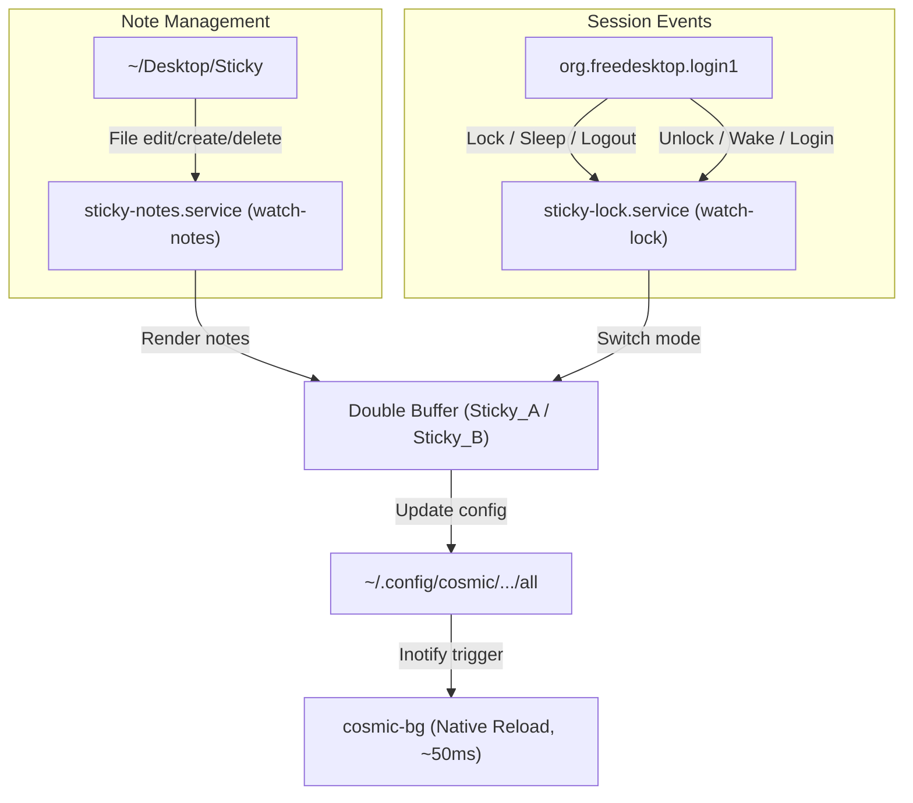

# Sticky Notes Wallpaper

Turns your COSMIC desktop wallpaper into a live, interactive sticky-note board. Notes in `~/Desktop/Sticky` are automatically rendered as frosted glass cards onto your wallpaper.

On lock, suspend, shutdown, or logout, the wallpaper instantly switches to a clean background. On unlock or login, your sticky notes seamlessly reappear.


## Main Highlights

- **100% Zero-Kill Wallpaper Updates:** Backgrounds update smoothly in ~50ms using native COSMIC double-buffering. `cosmic-bg` is never killed, eliminating flicker, restart delays, and systemd rate-limit errors.
- **Fully Automatic:** Notes refresh immediately on file save, edit, rename, or deletion.
- **Privacy on Lock:** Automatically switches to a clean wallpaper whenever you lock the screen or sleep, and restores notes when unlocked.
- **Zero-Config Installer:** Single command setup that auto-discovers paths and manages user systemd services.

---

## Dependencies

```bash
# Arch Linux
sudo pacman -S imagemagick inotify-tools

# Debian / Ubuntu / Pop!_OS
sudo apt install imagemagick inotify-tools
```

---

## Quick Setup (1-Step Install)

Clone the repository and run the automated installer:

```bash
git clone https://github.com/goodfeeling4/stickyglow.git ~/sticky
cd ~/sticky
./sticky install
```

The installer will:
1. Check for required dependencies (`imagemagick`, `inotify-tools`, `gdbus`).
2. Create `~/Desktop/Sticky` (if it does not exist).
3. Automatically configure and start `sticky-notes.service` and `sticky-lock.service`.
4. Configure your shell environment (`~/.bashrc` and `~/.local/bin/sticky`) so you can run `sticky` anywhere like a native Linux command.
5. Render your notes and apply the sticky wallpaper immediately.

---

## Usage

### Managing Notes
Simply put your notes in `~/Desktop/Sticky/`:
- **Create or edit a note:** Create or edit any text file in `~/Desktop/Sticky/`. The wallpaper re-renders automatically within seconds.
- **Remove a note:** Delete the file. The wallpaper updates immediately — no manual touches required!
- **Card Formatting:** The filename becomes the card header (mint green), and file content wraps neatly into frosted glass cards. Long notes automatically split into multiple paginated cards `(1/N)`.

### CLI Commands
Once installed, `sticky` works globally from any terminal directory:

```bash
# Switch to Sticky notes wallpaper
sticky sticky

# Switch to clean wallpaper (Normal mode)
sticky normal

# Manually trigger a note re-render
sticky render

# Check service health and logs
sticky status

# Reinstall or register services and command
sticky install

# Stop and remove background services & command
sticky uninstall
```

---

## How It Works



- **Zero-Kill Double Buffering:** Instead of overwriting a static file and killing `cosmic-bg`, `sticky.sh` alternates between `Sticky_A.png` and `Sticky_B.png`. Writing the updated path string into COSMIC's configuration triggers `cosmic-bg`'s internal inotify listener, reloading the wallpaper in ~50ms without killing any process.
- **`sticky-notes.service`:** Watches `~/Desktop/Sticky` for writes, creates, deletes, and renames with built-in debouncing.
- **`sticky-lock.service`:** Monitors `org.freedesktop.login1` signals for lock, unlock, sleep, and resume events.

---

## Project Structure

| File / Folder | Purpose |
|---|---|
| `sticky.sh` | Main controller CLI: installation, mode switching, watchers, and buffer management. |
| `glass_sticky.sh` | Frosted-glass rendering engine using ImageMagick. |
| `wallpapers/Slideshow/` | Pool of background images. |
| `wallpapers/Target/` | Generated double-buffer images (`Sticky_A.png`, `Sticky_B.png`, `normal_A.png`, `normal_B.png`). |
| `logs/sticky.log` | Central event and activity log. |
| `services/` | Systemd service unit templates (`sticky-notes.service`, `sticky-lock.service`). |
