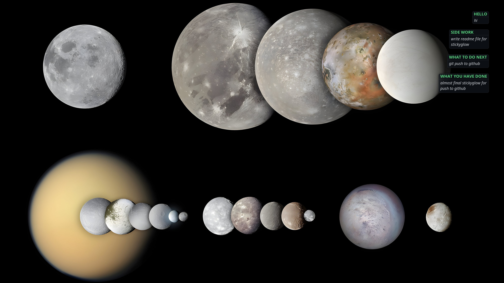

# Sticky Notes Wallpaper

Turns your COSMIC wallpaper or any into a live sticky-note board. `.txt` files in `~/Desktop/Sticky` are rendered as glass cards on the wallpaper. On lock/suspend/shutdown/logout the wallpaper switches to a clean one, and back to sticky on login.
## main highlight of this tool is :- 
   -  it's fully automatic when you change notes `.txt` file `~/Desktop/Sticky/` after closing write then automatic refresh notes on wallpaper .
   -  only visible sticky notes after login on poweroff/logout/suspend/lockscreen mean you close session its automatic goes normal walpaper. you can also change mode by ./sticky.sh and ./normal.sh 





## Dependencies

```bash
# Arch
sudo pacman -S imagemagick inotify-tools

# Debian/Ubuntu
sudo apt install imagemagick inotify-tools
```

- ImageMagick — `magick`/`convert`, used by the renderer
- inotify-tools — `inotifywait`, used by the note watcher
- COSMIC desktop — `cosmic-bg` and `gdbus`, already part of COSMIC
- systemd — runs the user services

## Setup

Scripts use absolute paths under `~/notes` — keep the repo there or fix paths in the scripts.

1. Add numbered images to `wallpapers/Slideshow/`.

2.
   ```bash
   mkdir -p ~/Desktop/Sticky
   ```
   Creates the notes folder the watcher monitors.

3.
   ```bash
   mkdir -p ~/.config/systemd/user
   cp services/*.service ~/.config/systemd/user/
   systemctl --user daemon-reload
   systemctl --user enable --now notify.service lockscreen_watcher.service restart_bg.service
   ```
   Installs the three user services. Background configs are copied by the scripts at runtime.

## Usage

No manual steps needed — the watchers do everything.

- **Add/edit a note:** save a `.txt` in `~/Desktop/Sticky`; wallpaper re-renders within a second.
- **Remove a note:** delete the `.txt`, then touch any remaining file to re-render.
- **Manual render:**
  ```bash
  ./glass_sticky.sh wallpapers/Slideshow/3.jpg ~/Desktop/Sticky/*.txt wallpapers/Target/Sticky.png
  ./sticky.sh
  ```
  Renders notes onto image `3.jpg` and applies it.
- **Force clean wallpaper:** `./normal.sh`
- **Watch the log:** `tail -f logs/lock.log`

## Notes

- Paths are hardcoded to this checkout; edit the scripts if you move things.
- `notify.sh` reacts to `close_write` events only — save complete files (editors do this); partial/streamed writes are ignored.


## How it works

Two modes for the COSMIC background:

- **Sticky** — a random slideshow image with your notes rendered on top.
- **Normal** — a clean random slideshow image.

| Service | Trigger | Action |
|---|---|---|
| `notify.service` (`notify.sh`) | file saved (`close_write`) in `~/Desktop/Sticky` | Re-render notes onto a new random wallpaper, apply it |
| `lockscreen_watcher.service` (`lockscreenWatch.sh`) | logind events via `gdbus` | Clean wallpaper on lock/suspend/shutdown/logout; sticky wallpaper on login |
| `restart_bg.service` | runs continuously | Keeps `cosmic-bg` itself alive (auto-restart) |

`notify.sh` and `lockscreenWatch.sh` are fully independent — each runs in its own service, so a note edit re-renders even outside a login event, and lock/logout switching never blocks note watching.

## Files

| File | Purpose |
|---|---|
| `glass_sticky.sh` | Renderer: `glass_sticky.sh <wallpaper.jpg> <note1.txt> ... [output.png]`. Filename → mint heading, long files split into `(1/N)` cards, cards stack down the right edge. |
| `notify.sh` | Watches `~/Desktop/Sticky`, re-renders on change. Runs as its own independent service. |
| `sticky.sh` | Applies sticky-mode config, restarts `cosmic-bg`. |
| `normal.sh` | Applies clean-mode config, stops watcher, restarts `cosmic-bg`. |
| `lockscreenWatch.sh` | Watches `org.freedesktop.login1`, switches modes. Runs as its own independent service. |
| `services/` | systemd user units (`notify.service`, `lockscreen_watcher.service`, `restart_bg.service`). |
| `setting_conf/` | COSMIC background configs (`normal`, `sticky`). |
| `wallpapers/Slideshow/` | Pool of background images (`0.jpg`, `1.jpg`, ...). |
| `wallpapers/Target/` | Generated images (`Sticky.png`, `normal.png`). |
| `logs/lock.log` | Watcher event log. |
